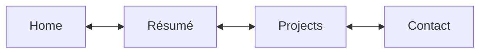

# Fauzan Afianto · QA Portfolio

A four-page portfolio about my work in software quality assurance, test automation, and testing architecture. [Visit afianto.dev](https://afianto.dev/)

I work across web, mobile, APIs, and data validation, using tools such as Playwright, Selenium, Postman, and Jenkins. On a healthcare automation migration, I helped the team raise the automated test pass rate from **68% to 90%** and expand the regression suite from **about 900 to 1,400 cases**.

## Explore the site

| Page | What you'll find |
| --- | --- |
| [Home](https://afianto.dev/) | My QA focus and a snapshot of project impact |
| [Résumé](https://afianto.dev/resume.html) | Work history, internships, university research, and technical skills |
| [Projects](https://afianto.dev/projects.html) | Case studies on automation migration, test coverage, CI/CD, and reporting |
| [Contact](https://afianto.dev/contact.html) | LinkedIn and GitHub profiles |



The navigation links jump directly to each page. With a mouse wheel or trackpad, continue scrolling at a page edge to move forward or back. Page fades respect the system's reduced-motion preference.

## How it’s built

- **HTML** for four standalone pages.
- **CSS** in [css/styles.css](css/styles.css) for responsive layouts, the gray and blue palette, and print styling.
- **Vanilla JavaScript** in [js/navigation.js](js/navigation.js) for scroll navigation and transition fallback.
- **GitHub Pages** serves the static files. [CNAME](CNAME) configures the custom domain.

## Preview locally

Clone the repository, then serve it with Python 3. There are no package dependencies or build steps.

```sh
git clone https://github.com/thearticle/fauzan.github.io.git
cd fauzan.github.io
python -m http.server 8000
```

[Open the local preview](http://localhost:8000/) and use the navigation to check the other pages.
